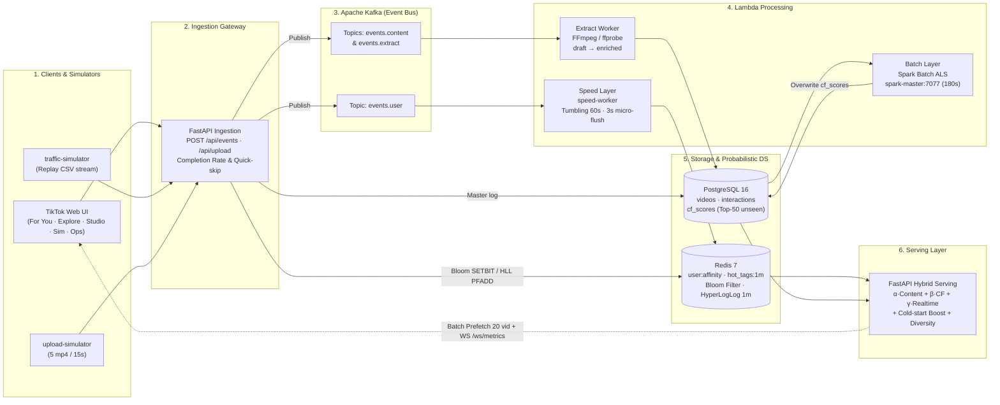
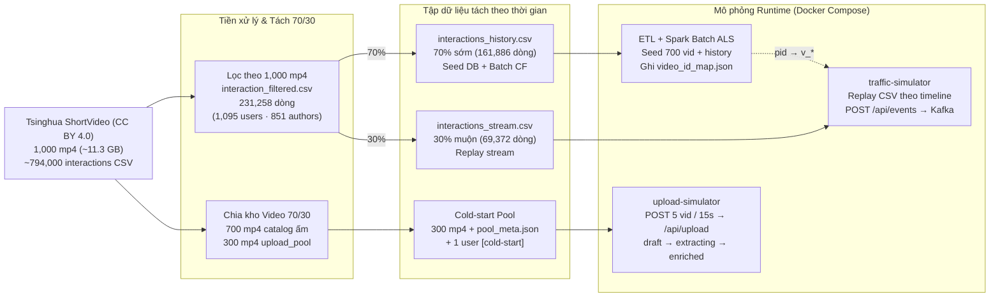

# Mã Mermaid chuẩn cho Hình 2.1 & Hình 3.1

Bạn có thể copy từng khối Mermaid bên dưới dán trực tiếp vào:
- **Mermaid Live Editor:** https://mermaid.live (chọn theme `neutral` hoặc `base`, xuất PNG độ phân giải cao)
- **Draw.io (diagrams.net):** Menu *Arrange → Insert → Advanced → Mermaid...* rồi tự căn chỉnh màu sắc/icon theo ý thích
- **Eraser.io (DiagramGPT / Diagram as Code):** Dán trực tiếp để render phong cách kiến trúc cloud chuyên nghiệp

Lưu 2 file xuất ra đúng tên:
1. `Báo cáo/latex/graphics/placeholders/architecture.png`
2. `Báo cáo/latex/graphics/placeholders/data-simulation.png`

---

## Hình 2.1 — Sơ đồ kiến trúc Lambda của StreamRec (`architecture.png`)

---

## Hình 3.1 — Luồng chuẩn bị dữ liệu & Mô phỏng Runtime (`data-simulation.png`)

