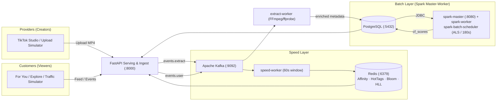

# StreamRec — Hệ thống Gợi ý Video Ngắn Thời gian Thực (Big Data CO3137)

> Đồ án môn học **Dữ liệu lớn (CO3137)** — Trường Đại học Bách Khoa, ĐHQG-HCM (HCMUT)  
> Chủ đề: **Video/Image → Metadata → Hybrid Recommendation Systems (Providers & Customers)**

[](#2-kiến-trúc-hệ-thống--12-docker-services)
[](#2-kiến-trúc-hệ-thống--12-docker-services)
[](#2-kiến-trúc-hệ-thống--12-docker-services)
[](B%C3%A1o%20c%C3%A1o/latex/main.pdf)

---

## 1. Tổng quan đề tài

**StreamRec** mô phỏng hoàn chỉnh một nền tảng gợi ý video ngắn theo phong cách **TikTok**, triển khai pipeline dữ liệu lớn đầu-cuối:

$$\text{Video/Image} \longrightarrow \text{Async Metadata Extraction (FFmpeg/ffprobe)} \longrightarrow \text{Hybrid Recommendation (Batch + Speed + Content)}$$

Hệ thống phục vụ đồng thời hai vai trò cốt lõi:
- **Providers (Nhà sáng tạo nội dung):** Đăng tải video qua **TikTok Studio**, hệ thống tách metadata kỹ thuật bất đồng bộ qua Apache Kafka (`draft` → `extracting` → `enriched`) và tự động kích hoạt **Cold-start Traffic Pool Boost** để video mới nhanh chóng tiếp cận người xem.
- **Customers (Người xem):** Lướt bảng tin cá nhân hóa **For You**, tương tác thời gian thực (*view, like, share, auto-skip < 2s*), chuyển đổi linh hoạt giữa người dùng có lịch sử và người dùng `[cold-start]`, đồng thời bật **Show Big Data** để quan sát trực tiếp điểm Hybrid, Bloom Filter và bảng **Top 10 Live Diff**.

### Đáp ứng 4V của Big Data & Kiến trúc Lambda

| Đặc trưng 4V | Hiện thực trong StreamRec |
| :--- | :--- |
| **Volume** | Bộ dữ liệu thực tế **Tsinghua ShortVideo** (~1.000 video MP4, 231.258 tương tác sau lọc: 161.886 history + 69.372 stream). Cụm Spark Batch ALS xử lý và ghi **144.350 cặp điểm** cho **2.887 users × 695 videos**. |
| **Velocity** | Backbone **Apache Kafka** (5 topics, 3 partitions/topic); `traffic-simulator` phát lại log tương tác lịch sử tăng tốc (`SPEEDUP=3600`, mục tiêu tới 200 events/s); `speed-worker` tổng hợp cửa sổ trượt 60s (flush mỗi 3s) vào Redis. |
| **Variety** | Kết hợp đa dạng nguồn dữ liệu: video nhị phân (MP4), metadata bán cấu trúc (tags, category, ffprobe JSON), dữ liệu quan hệ (PostgreSQL), sự kiện streaming (Kafka) và cấu trúc trạng thái tốc độ cao (Redis). |
| **Veracity** | Lọc nhất quán tương tác khớp với video MP4 tồn tại, loại bỏ tag nhiễu nội bộ, chống rò rỉ dữ liệu kiểm thử (no test leakage) khi đánh giá offline 70/30, xử lý tín hiệu âm (auto-skip `<2s`) và lọc trùng bằng Bloom Filter. |

---

## 2. Kiến trúc hệ thống & 12 Docker services

StreamRec vận hành theo **Kiến trúc Lambda** gồm 3 tầng độc lập:
- **Batch Layer:** Cụm Apache Spark Master–Worker (`spark-master`, `spark-worker`, `spark-batch-scheduler`) định kỳ mỗi 180s huấn luyện mô hình lọc cộng tác **ALS** (Spark MLlib) trên toàn bộ lịch sử PostgreSQL và ghi Top 50 gợi ý chuẩn hóa $[0, 1]$ vào bảng `cf_scores`.
- **Speed Layer:** `speed-worker` tiêu thụ sự kiện từ Kafka (`events.user`), cập nhật hồ sơ sở thích phiên (`user:affinity:{user_id}`) và xếp hạng thẻ thịnh hành cửa sổ 60s (`metrics:hot_tags:1m`) trên Redis.
- **Serving Layer:** FastAPI (`api`) hợp nhất tín hiệu Content-based, Batch CF và Speed Layer trong thời gian thực, kết hợp Bloom Filter, Cold-start Boost và Greedy Diversity Re-ranking.



### Danh sách 12 dịch vụ Docker chạy thường trực (+ `kafka-init`)

| # | Service | Công nghệ / Image | Cổng Host | Vai trò |
| :-: | :--- | :--- | :---: | :--- |
| 1 | `postgres` | `postgres:16-alpine` | `5432` | Master dataset (`videos`, `interactions`, `cf_scores`, `follows`, `serving_weights`). |
| 2 | `redis` | `redis:7-alpine` | `6379` | Cache tốc độ cao: `user:affinity:*`, `metrics:hot_tags:1m`, Bloom Filter, HyperLogLog. |
| 3 | `kafka` | `bitnamilegacy/kafka:3.7` (KRaft) | `9092` | Message broker phân tán cho các luồng sự kiện và trích xuất metadata. |
| — | `kafka-init` *(init)* | `bitnamilegacy/kafka:3.7` | — | One-shot container tạo 5 topics (`events.user`, `events.content`, `events.extract`, `features.user`, `features.item`, 3 partitions/topic) rồi thoát mã `0`. |
| 4 | `spark-master` | `bitnamilegacy/spark:3.5` | `8080`, `7077` | Điều phối tài nguyên cụm Spark & cung cấp Spark Master Web UI. |
| 5 | `spark-worker` | `bitnamilegacy/spark:3.5` | — | Nút thực thi Executor (2 cores, 2G RAM) chạy Spark MLlib ALS. |
| 6 | `spark-batch-scheduler` | `bitnamilegacy/spark:3.5` | — | Lập lịch tự động gửi `spark-submit /opt/jobs/batch_cf.py` mỗi **180 giây**. |
| 7 | `api` | FastAPI (`apps/api`) | `8000` | Ingest sự kiện, Upload media, Hybrid Recommendation API, Metrics & Admin API. |
| 8 | `extract-worker` | Python + FFmpeg (`apps/extract-worker`) | — | Trích xuất metadata video bất đồng bộ (`duration`, độ phân giải, fps, thumbnail, tags). |
| 9 | `speed-worker` | Python Kafka (`apps/speed-worker`) | — | Speed Layer: tổng hợp cửa sổ tumbling 60s (flush mỗi 3s) vào Redis. |
| 10 | `traffic-simulator` | Python (`apps/traffic-simulator`) | — | Replay log tương tác thật `interactions_stream.csv` qua `video_id_map.json`. |
| 11 | `upload-simulator` | Python (`apps/upload-simulator`) | — | Giả lập Provider đăng tự động 5 video cold-start / 15s từ `data/coldstart/upload_pool`. |
| 12 | `web` | React + Vite + Nginx (`apps/web`) | `5173` | Giao diện TikTok Web (5 màn hình) & bảng điều khiển System Ops. |

*(Ngoài ra, `docker-compose.yml` còn cung cấp 2 service tùy chọn `spark-batch` và `spark-speed` thuộc `--profile spark-jobs` để kích hoạt thủ công.)*

### Công thức Hybrid Recommendation & Cấu trúc Dữ liệu Xác suất

1. **Điểm xếp hạng Hybrid (`apps/api/app/recommend.py`):**

   $$\text{Score}(u, v) = \alpha \cdot s_{\text{content}}(u, v) + \beta \cdot s_{\text{cf}}(u, v) + \gamma \cdot s_{\text{realtime}}(u, v) + b_{\text{cold}}(v) + \varepsilon_{\text{tie}}$$

   - Mặc định: $\alpha = 0.35$ (Cosine Similarity hồ sơ tag nội dung), $\beta = 0.35$ (Batch CF từ Spark ALS chuẩn hóa $[0, 1]$), $\gamma = 0.30$ (Realtime affinity từ Speed Layer Redis). Có thể điều chỉnh trực tiếp theo thời gian thực trên `/dashboard`.
   - **Cold-start Traffic Pool Boost:** $b_{\text{cold}}(v) = 0.08 \times \left(1 - \frac{\text{age\_min}}{30}\right)$ cho video trạng thái `enriched` mới đăng trong vòng 30 phút đầu.
   - **Greedy Diversity Re-ranking:** Ngăn chặn hai video liên tiếp cùng một creator và không quá hai video liên tiếp cùng một category.

2. **Bloom Filter (Lọc video đã xem — `apps/api/app/probabilistic.py`):**
   - Lưu trên Redis tại key `bf:seen:{user_id}` với mảng bit $m = 8\,192$ bits (**1 KB/user**), $k = 5$ hàm băm (double hashing từ SHA-256), TTL 7 ngày.
   - Loại bỏ nhanh các video người dùng vừa xem/bỏ qua khỏi đầu bảng tin mà không cần quét bảng `interactions`.

3. **HyperLogLog 1 phút (Đếm người dùng hoạt động duy nhất):**
   - Duy trì 6 thanh ghi HyperLogLog trượt theo khung 10 giây (`hll:active_10s:{bucket}`, 6 × 10s = 60s) và hợp nhất bằng lệnh `PFCOUNT` để trả về `hll_active_1m` với sai số chuẩn $\approx 0.81\%$ và bộ nhớ cố định cực nhỏ, song song với `hll:active_users` tích lũy toàn hệ thống.

---

## 3. Yêu cầu hệ thống

- **Docker Desktop** (Windows/macOS) hoặc **Docker Engine + Docker Compose v2** (Linux), cấp phát tối thiểu **6 GB RAM** (khuyến nghị 8 GB RAM, 4 CPU cores).
- **Python 3.10+** (dùng để chạy các script tải, tiền xử lý, ETL dữ liệu và đánh giá offline).
- **Dung lượng ổ cứng trống:** khoảng **12 GB** để chứa bộ dữ liệu thật Tsinghua ShortVideo (~1.000 video MP4 + CSV) cùng Docker images/volumes.

---

## 4. Hướng dẫn cài đặt & chạy từ đầu từng bước

Các lệnh dưới đây dùng chung và có thể **copy-paste chạy trực tiếp** trên cả **Windows PowerShell** lẫn **Linux/macOS** tại thư mục gốc của repository.

### Bước 1: Khởi chạy toàn bộ Docker stack

```bash
docker compose up --build -d
```

Chờ khoảng 30–60 giây để Kafka, PostgreSQL, Redis, Spark và các worker khởi tạo hoàn tất.

### Bước 2: Cài đặt thư viện Python cho script dữ liệu

```bash
pip install -r scripts/data/requirements.txt
```

*(Nếu muốn chạy thêm kịch bản đánh giá định lượng offline ở Mục 6, cài bổ sung `pip install numpy`.)*

### Bước 3: Tải & chuẩn hóa dữ liệu thật Tsinghua ShortVideo

Tải ~1.000 video MP4 (hỗ trợ resume, giới hạn mỗi file $\le 20\text{ MB}$), lọc CSV tương tác khớp video hợp lệ, tách 70/30 theo thời gian (`interactions_history.csv` / `interactions_stream.csv`), và tách 30% video làm bể cold-start (`data/coldstart/upload_pool`):

```bash
python scripts/data/download_shortvideo_fast.py --out data/raw/shortvideo --max-videos 1000 --workers 3 --max-mb 20.0
python scripts/data/filter_interactions_by_videos.py --root data/raw/shortvideo
python scripts/data/split_interactions.py --root data/raw/shortvideo --source interaction_filtered.csv
python scripts/data/split_coldstart_pool.py --fraction 0.30 --seed 42
```

> Xem thêm chi tiết nguồn dữ liệu tại [docs/data-provenance.md](docs/data-provenance.md) và cơ chế replay luồng tại [docs/data-simulation.md](docs/data-simulation.md).

### Bước 4: Nạp catalog + lịch sử tương tác & tạo user Cold-start

Nạp tối đa 700 video catalog cùng lịch sử tương tác vào PostgreSQL/media volume, xuất `video_id_map.json` (cho `traffic-simulator`), sau đó tạo sẵn 1 người dùng `[cold-start]` (0 lịch sử) để demo:

```bash
python scripts/data/etl_shortvideo.py --purge --root data/raw/shortvideo --max-videos 700
python scripts/data/reset_coldstart_user.py --api http://localhost:8000
```

### Bước 5: Kiểm tra nhanh trạng thái & các URL dịch vụ

Kiểm tra container (`12` service `Up/Healthy`, `kafka-init` đã thoát mã `0`):

```bash
docker compose ps
```

Truy cập các đường dẫn:
- **TikTok Web UI:** <http://localhost:5173>
- **API Healthcheck:** <http://localhost:8000/health>
- **Spark Master UI:** <http://localhost:8080>

---

## 5. Giao diện TikTok Web & Kịch bản demo 6 phút

### 5 màn hình chính (`apps/web/src/App.jsx`)

| Màn hình | Đường dẫn | Mô tả chức năng |
| :--- | :--- | :--- |
| **For You** | `/` | Bảng tin video dọc cá nhân hóa; hỗ trợ chuyển nhanh Customer (user lịch sử hoặc `[cold-start]`), Like / Share / Follow / auto-skip `< 2s`. |
| **Explore** | `/trending` | Danh sách video thịnh hành từ Speed Layer (cửa sổ 60s `metrics:hot_tags:1m`) và thanh tìm kiếm theo tiêu đề, `#hashtag`, `@creator`. |
| **TikTok Studio** | `/studio` | Giao diện dành cho Provider đăng video mới, theo dõi pipeline bất đồng bộ `draft` → `extracting` → `enriched` kèm thông số `ffprobe`. |
| **Live Simulation** | `/simulation` | Tường giả lập **5+5 điện thoại** (5 Customer + 5 Provider) chạy song song thời gian thực, trực quan hóa tương tác hai chiều. |
| **System Ops** | `/dashboard` | Trung tâm giám sát Big Data: throughput (events/sec), HyperLogLog active users 1 phút, Hot Tags 60s, thanh trượt chỉnh trọng số $\alpha/\beta/\gamma$, trạng thái Extract worker & Spark Batch ALS. |

> **Nút `Show Big Data`:** Nằm trên thanh topbar ở các trang *For You*, *Explore* và *TikTok Studio*. Khi bật, giao diện mở ngăn thanh tra trực tiếp hiển thị công thức điểm Hybrid (`content`, `cf_batch`, `realtime`, `cold_boost`), hồ sơ affinity Redis, số lượng video đã lọc qua Bloom Filter và bảng **Top 10 Live Diff** kèm nút **Apply & Re-rank**.

### Kịch bản demo bảo vệ (6 phút)

1. **For You — Customer Cold-start & Live Diff (~1,5 phút):** Chọn user `[cold-start]` (0 lịch sử), lướt và bấm Like 2–3 video cùng chủ đề hoặc lướt nhanh `<2s` (auto-skip). Bật **Show Big Data** để quan sát affinity, Bloom Filter và bảng **Top 10 Live Diff**, sau đó bấm **Apply & Re-rank** để thấy bảng tin lập tức dịch chuyển theo sở thích mới.
2. **Explore (Speed Layer) & Live Simulation 5+5 (~1,5 phút):** Mở `/trending` và bật **Show Big Data** đối chiếu video dẫn đầu với bảng Hot Tags 60s (`metrics:hot_tags:1m`); tiếp tục mở `/simulation` trình diễn tường 5 Customer + 5 Provider chạy đồng thời.
3. **TikTok Studio — Provider Upload & Cold-start Boost (~1,5 phút):** Đăng một video mới tại `/studio` (hoặc quan sát `upload-simulator`), bật **Show Big Data** xem trạng thái chuyển `draft` → `extracting` → `enriched` kèm metadata `ffprobe`, rồi quay lại `/` kiểm tra video mới được hưởng Cold-start Boost.
4. **System Ops (`/dashboard`) & Spark UI (`:8080`) (~1,5 phút):** Trình bày biểu đồ throughput realtime (events/sec), chỉ số **HyperLogLog** 1 phút, điều chỉnh trực tiếp $\alpha/\beta/\gamma$, và mở `http://localhost:8080` chứng minh cụm Spark Master–Worker (`Alive Workers = 1`) đã hoàn tất job **Spark Batch ALS** (`recsys-batch-als`).

> **Mẹo khi demo:** Khởi động stack trước ~3 phút để `spark-batch-scheduler` hoàn tất ít nhất một chu kỳ 180s (~43s thực thi), giúp job `recsys-batch-als` sẵn sàng ở trạng thái `FINISHED` trên Spark UI `:8080`.

---

## 6. Đánh giá định lượng Offline (Hold-out 70/30)

Để đánh giá khách quan chất lượng gợi ý trên bộ dữ liệu thật Tsinghua ShortVideo, hệ thống thực hiện đánh giá hold-out theo trục thời gian: huấn luyện trên **70% tương tác sớm** (`interactions_history.csv`, 161.886 dòng) và kiểm thử Top-10 trên **30% tương tác muộn** (`interactions_stream.csv`, 69.372 dòng; tách 20% đầu làm hồ sơ phiên và 80% sau làm nhãn ground-truth để đảm bảo **no test leakage**).

Chạy lại thí nghiệm đánh giá:

```bash
python scripts/data/eval_offline.py
```

### Kết quả thực nghiệm trên 2.133 người dùng (Hold-out 30%)

| Mô hình / Cấu hình | Precision@10 | Recall@10 | NDCG@10 |
| :--- | :---: | :---: | :---: |
| Popularity baseline | 0.0004 | 0.0025 | 0.0011 |
| Batch CF — SVD/ALS ($\beta = 1$) | 0.0029 | 0.0136 | 0.0068 |
| **Hybrid ($\alpha = 0.35,\ \beta = 0.35,\ \gamma = 0.30$)** | **0.0043** | **0.0205** | **0.0119** |
| Content-based ($\alpha = 1$) | 0.0054 | 0.0247 | 0.0158 |

**Nhận xét:**
- Toàn bộ các mô hình cá nhân hóa đều vượt xa *Popularity baseline* từ **5 đến 14 lần** trên cả 3 độ đo (Batch CF gấp 5,4–7,3×; Hybrid gấp 8,2–10,8×; Content-based gấp 9,9–14,4×).
- Trên phép đo offline tĩnh với độ thưa ma trận cao, Content-based thuần nhỉnh hơn Hybrid; tuy nhiên trong vận hành trực tuyến, **Hybrid** mang lại hai năng lực thiết yếu mà Content thuần không có: khám phá nội dung chéo chủ đề từ **Batch CF (Spark ALS)** và thích nghi tức thời theo hành vi trong phiên từ **Speed Layer**.

---

## 7. Cấu trúc thư mục, Tài liệu & Troubleshooting

### Cấu trúc thư mục (Repo Map)

```text
.
├── apps/
│   ├── api/                 # FastAPI: Ingest, Hybrid Serving, Bloom/HLL, Metrics, Admin
│   ├── web/                 # React + Vite: TikTok Web UI (5 màn hình + Show Big Data)
│   ├── extract-worker/      # Kafka consumer trích xuất metadata video bằng FFmpeg/ffprobe
│   ├── speed-worker/        # Speed Layer: cửa sổ tumbling 60s -> Redis
│   ├── traffic-simulator/   # Replay luồng interactions_stream.csv qua video_id_map.json
│   └── upload-simulator/    # Tự động đăng video cold-start từ data/coldstart/upload_pool
├── jobs/
│   └── spark/               # PySpark Batch ALS (batch_cf.py) & Streaming (speed_stream.py)
├── scripts/
│   └── data/                # Download, filter, split 70/30, cold-start pool, ETL & eval_offline.py
├── docs/
│   ├── architecture.md      # Chi tiết kiến trúc Lambda & sơ đồ luồng dữ liệu
│   ├── data-provenance.md   # Nguồn gốc & tiền xử lý dữ liệu Tsinghua ShortVideo
│   ├── data-simulation.md   # Cơ chế replay stream & cold-start upload pool
│   └── mo-ta-website.md     # Mô tả chi tiết các màn hình giao diện Web
├── Báo cáo/
│   └── latex/               # Mã nguồn LaTeX & báo cáo tổng kết (main.pdf)
└── docker-compose.yml       # Khai báo 12 dịch vụ thường trực + kafka-init + spark-jobs profile
```

### Báo cáo & Tài liệu tham khảo

- **Báo cáo tổng kết (PDF):** [Báo cáo/latex/main.pdf](B%C3%A1o%20c%C3%A1o/latex/main.pdf)
- **Kiến trúc hệ thống:** [docs/architecture.md](docs/architecture.md)
- **Nguồn dữ liệu ShortVideo:** [docs/data-provenance.md](docs/data-provenance.md)
- **Mô phỏng luồng dữ liệu:** [docs/data-simulation.md](docs/data-simulation.md)
- **Mô tả giao diện Web:** [docs/mo-ta-website.md](docs/mo-ta-website.md)

### Troubleshooting

- **Tắt hệ thống an toàn (giữ nguyên dữ liệu PostgreSQL & media volume):**
  ```bash
  docker compose down
  ```
  *(Tránh dùng cờ `-v` nếu bạn không muốn xóa dữ liệu đã nạp từ Bước 4.)*
- **Spark Master UI (`http://localhost:8080`) chưa thấy job `recsys-batch-als` hoàn tất:** `spark-batch-scheduler` chạy theo chu kỳ 180s. Bạn có thể đợi hết chu kỳ hoặc kích hoạt chạy ngay lập tức một lượt thủ công:
  ```bash
  docker compose --profile spark-jobs run --rm spark-batch
  ```
- **Thiếu RAM / container tự khởi động lại (OOMKill):** Mở **Docker Desktop → Settings → Resources** và tăng giới hạn Memory lên tối thiểu **6 GB** (khuyến nghị 8 GB), sau đó chạy lại `docker compose up -d`.
- **`traffic-simulator` chưa phát sự kiện lên Dashboard:** Đảm bảo Bước 4 (`etl_shortvideo.py`) đã chạy thành công và sinh tệp `data/raw/shortvideo/video_id_map.json`.
- **Lỗi thiếu `numpy` khi chạy `eval_offline.py`:** Chạy `pip install numpy` rồi thực thi lại `python scripts/data/eval_offline.py`.

---

## Thành viên nhóm thực hiện

| STT | Họ và tên | MSSV |
| :-: | :--- | :---: |
| 1 | **Nguyễn Thiện Minh** | `2312097` |
| 2 | **Phan Nguyễn Hoàng Nam** | `2312183` |
| 3 | **Nguyễn Đặng Thế Hoàng** | `2311051` |
| 4 | **Phan Đức Nhã** | `2312410` |
