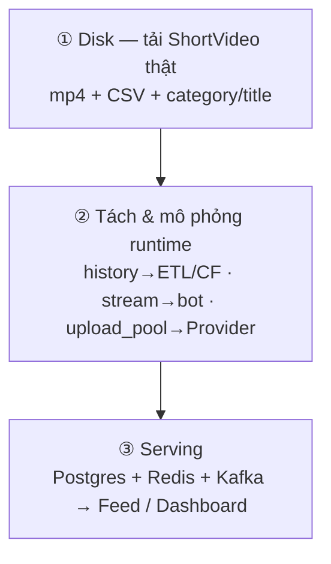
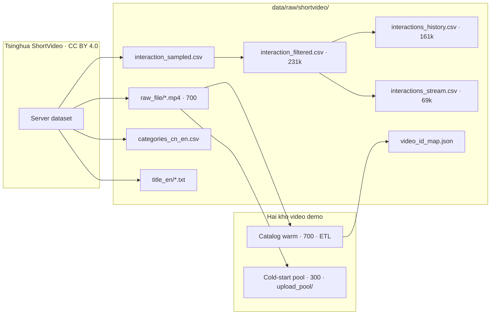
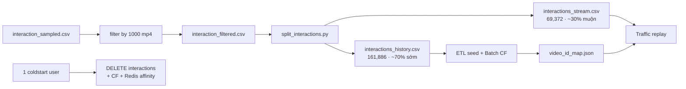
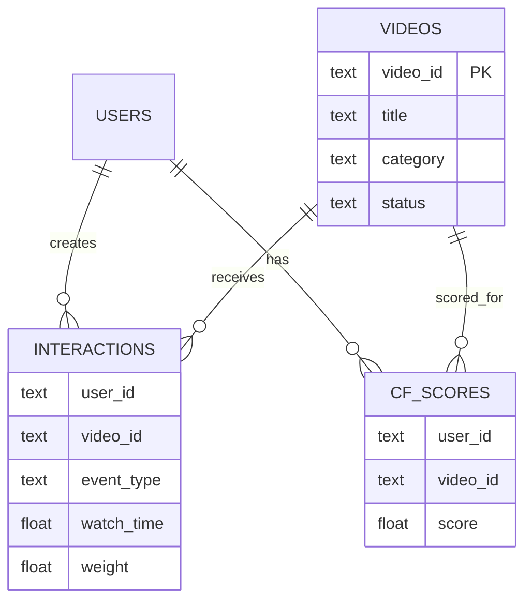

# Dữ liệu tải về & mô phỏng StreamRec

Tài liệu tái sử dụng cho demo / báo cáo Big Data (CO3137).  
Thiết kế chốt: **CSV interaction thật tách 70/30** · **bot replay stream** · **cold-start video + cold-start 1 user**.

Số liệu disk lúc ghi: **1000 mp4 (~11.3 GB)** · catalog ấm **700** · `upload_pool` **300** · CSV gốc **~794k** · filtered **231,258** · history **161,886** · stream **69,372**.

---

## 0. Ba lớp dữ liệu (ý chính)



| Lớp | Câu hỏi demo | Trả lời bằng |
|-----|--------------|--------------|
| Disk | Dữ liệu có thật không? | mp4 + CSV Tsinghua (CC BY 4.0) |
| Mô phỏng | Streaming gần production thế nào? | Replay interaction muộn + upload cold-start |
| Serving | Recommend đổi theo hành vi? | Hybrid `α·content + β·cf + γ·realtime` |

---

## 1. Đã tải về gồm gì



| Thành phần | Vai trò |
|------------|---------|
| `raw_file/*.mp4` | Catalog ấm **700** mp4 (sau split 30%) |
| `interaction_sampled.csv` | CSV gốc ~794k dòng, **28 cột** — giữ nguyên |
| `interaction_filtered.csv` | Chỉ row có `pid` đã tải (**231,258** / 1000 pid) |
| `interactions_history.csv` | **70% sớm** trên tập đã lọc → seed DB / Batch CF |
| `interactions_stream.csv` | **30% muộn** → traffic bot **replay thật** |
| `video_id_map.json` | `pid` dataset → `video_id` hệ thống (`v_…`) — tạo sau ETL |
| `categories_cn_en.csv` / `title_en/` | Nhãn category + title EN |
| `data/coldstart/upload_pool/` | Cold-start **300** video — upload-simulator POST multipart mỗi ~90s × 5 vid |

---

## 2. CSV interaction — 28 cột

**Một dòng = một lần user được expose / tương tác với một video.**

### Nhóm cốt lõi (ETL / bot dùng)

| Cột | Ý nghĩa | Map sang hệ thống |
|-----|---------|-------------------|
| `user_id` | User dataset | `sv_<user_id>` |
| `pid` | Video id gốc | `video_id_map[pid]` → `v_…` |
| `watch_time` | Giây xem | `watch_time` |
| `duration` | Độ dài video | tham chiếu |
| `cvm_like` / `click` / `comment` / `follow` / `collect` / `forward` / `hate` | Cờ True/False | → `event_type` (`like` / `share` / `skip` / `watch`) |
| `tag_name`, `title`, `category_id` | Metadata nội dung | tags / category |
| `author_id` | Chủ kênh | `creator_id` |

### Nhóm ngữ cảnh (ít dùng serving hiện tại)

`exposed_time`, `p_hour`, `p_date`, `author_fans_count`, `category_level`, `parent_id`, `root_id`, `gender`, `age`, `mod_price`, `fre_city`, `fre_community_type`, `fre_city_level`.

`exposed_time` (fallback `p_date`) dùng để **tách 70/30** history vs stream trên `interaction_filtered.csv`.  
Cutoff đã chạy: `exposed_time = 1663653505`.

---

## 3. Tách history / stream + runtime



| Kênh | Dữ liệu | Việc làm |
|------|---------|----------|
| **ETL / Batch** | `interactions_history.csv` + mp4 warm | Upload catalog → Postgres → Batch CF → ghi `video_id_map.json` |
| **Traffic bot** | `interactions_stream.csv` + map | `POST /api/events` đúng `(sv_user, video, event, watch_time)` từ CSV — **không** tạo `bot_*` giả |
| **Upload cold-start** | `upload_pool/*.mp4` | Mỗi ~90s upload **5** video (Provider Studio: draft → extract → enriched) |
| **Cold-start user** | 1 `sv_*` (demo) | Xóa hết interaction / CF / affinity → For You thấy `[cold-start] · 0 history` |

### Payload event (API) — bot và người thật cùng format

```json
{
  "user_id": "sv_7313",
  "video_id": "v_abc…",
  "event_type": "watch",
  "watch_time": 12.5
}
```

Bot chỉ replay row có `pid` đã có trong `video_id_map.json`.  
Pace theo **timeline CSV** (`exposed_time`): `sleep = Δt / SPEEDUP` (mặc định `SPEEDUP=3600`), khoảng cách lớn bị cắt bởi `MAX_GAP_SLEEP` (0.05s); cụm cùng timestamp bị giới hạn bởi `EVENTS_PER_SEC` (trần burst, mặc định 200).

---

## 4. Cấu trúc bản ghi serving



Serving: `score = α·content + β·cf_batch + γ·realtime`.

- **Content** — tags/category (và affinity Redis sau khi user tương tác).  
- **CF batch** — từ `interactions_history` (user cold-start = 0 điểm CF).  
- **Realtime** — cửa sổ speed từ Kafka events (bot stream + user demo).

---

## 5. Script nhanh

```bash
# 1) Tải 1000 mp4 (resume cache)
python scripts/data/download_shortvideo_fast.py --out data/raw/shortvideo --max-videos 1000 --workers 3 --max-mb 20.0

# 2) Lọc CSV theo pid có file + tách history/stream 70/30
python scripts/data/filter_interactions_by_videos.py --root data/raw/shortvideo
python scripts/data/split_interactions.py --root data/raw/shortvideo --source interaction_filtered.csv

# 3) Chia cold-start video 30% → upload_pool (move)
python scripts/data/split_coldstart_pool.py --fraction 0.30 --seed 42

# 4) ETL catalog ấm (~700) + map pid→v_* + cold-start 1 user
python scripts/data/etl_shortvideo.py --purge --root data/raw/shortvideo --max-videos 700
python scripts/data/reset_coldstart_user.py --api http://localhost:8000
```

| Việc | File |
|------|------|
| Lọc CSV theo mp4 | `scripts/data/filter_interactions_by_videos.py` |
| Split video warm / cold | `scripts/data/split_coldstart_pool.py` |
| Bot replay stream | `apps/traffic-simulator/simulator.py` |
| Admin wipe user | `POST /api/admin/coldstart-user` |
| Provenance / license | `docs/data-provenance.md` |
